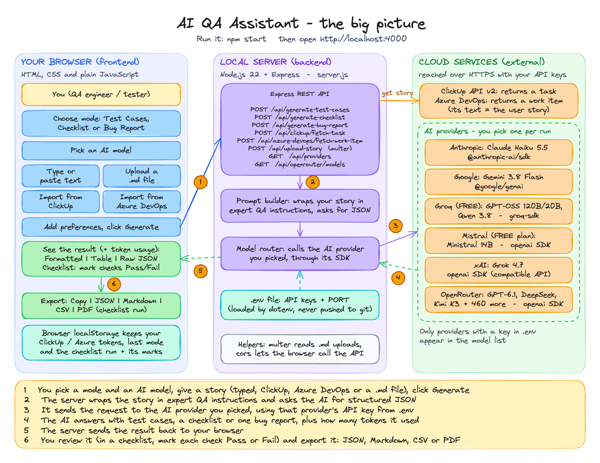

# AI QA Assistant

A web application that uses the latest AI models (**Claude Haiku 5.5**, **Gemini 3.8 Flash**, **GPT-OSS 120B**, and 460+ models via **OpenRouter**) to generate comprehensive test cases and manual test checklists from user stories, and professional bug reports from issue descriptions.

## Features

- **Test Case Generation**: Turns a user story into test cases in the user-story-test-case-generator skill's format: a Part 1 analysis (requirement inventory, assumptions, open questions, risks, coverage summary and time estimate) and a Part 2 table in the skill's 12-column, one-row-per-step layout, plus a Priority column (High/Medium/Low)
- **Manual Test Checklist**: Switch to *Checklist* to turn a user story into checks you run by hand on the app and mark **Pass** or **Fail**, with a note on each failure. Every check cites the story lines it verifies (L1, L2, ...), and a story coverage table shows each line's result. Any line with no check is flagged, and *Add checks for missing lines* fills the gap, so no line of the story goes untested. Marks are saved in the browser, so a reload doesn't lose a run in progress. *Reset results* clears the marks and notes; *Clear checklist* deletes the whole run
- **Bug Report Mode**: Switch to *Bug Report* to turn an issue description into one bug report in the bug-report-generator skill's format (Title, Link, Environment, Steps to Reproduce, Actual/Expected Result, API Evidence for backend bugs, Severity, Priority)
- **Multiple Input Methods**:
  - **Manual Input**: Type or paste text directly (or click *Load Example*)
  - **ClickUp Import**: Import a user story directly from a ClickUp task
  - **Azure DevOps Import**: Import a work item (user story, product backlog item or bug) by its ID or link, with its description, acceptance criteria and comments. Tables keep each row on one line, so story IDs stay next to their text. Comments come last, oldest first, so a decision made in the discussion (a changed limit, a new rule) gets checked instead of the outdated rule
  - **File Upload**: Upload a markdown (`.md`) file
- **Multi-Model Support**: Claude Haiku 5.5, Gemini 3.8 Flash, GPT-OSS (120B & 20B), Qwen 3.8, and via OpenRouter: Grok 4.7, GPT-6.1 Sol Pro, DeepSeek V4.1 Flash, Kimi K3, or any model from a searchable picker. Only providers with a configured API key are shown
- **Preferences**: Override the defaults per run, e.g. owner, test case ID prefix, coverage focus or language
- **Three Result Views**: Formatted, Table (spreadsheet-style grid in the template layout) and Raw JSON
- **Export**: Copy as Markdown, or download as JSON, Markdown (the skill's file layout) or CSV (opens in Excel, Arabic included). A checklist run can also be saved as a PDF report: the checks as cards with their Pass/Fail result and notes
- **Token Usage Tracking**: See the model used and input/output tokens for each generation

## How It Works



1. You pick a mode and an AI model, give a story (typed, from ClickUp or Azure DevOps, or a `.md` file) and click **Generate**
2. The local server wraps the story in expert QA instructions and asks the AI for structured JSON
3. It sends the request to the AI provider you picked, using that provider's API key from `.env`
4. The AI answers with test cases, a checklist or one bug report, plus how many tokens it used
5. The server sends the result back to your browser
6. You review it as Formatted / Table / Raw JSON (in a checklist, marking each check Pass or Fail) and export it as JSON, Markdown, CSV or, for a checklist run, PDF

The editable source of the diagram is [`docs/architecture.excalidraw`](docs/architecture.excalidraw); open it at [excalidraw.com](https://excalidraw.com) to change it.

## Prerequisites

- Node.js **22 or higher** (required by the `openai` SDK)
- npm
- An API key for **at least one** provider:
  - Anthropic: https://console.anthropic.com/settings/keys
  - Google Gemini: https://aistudio.google.com/apikey
  - Groq (free): https://console.groq.com/keys
  - Mistral (free plan): https://console.mistral.ai/api-keys
  - xAI: https://console.x.ai/
  - OpenRouter: https://openrouter.ai/keys

## Installation

1. Clone the repository:
```bash
git clone https://github.com/muhamed-atallah/ai-qa-assistant.git
cd ai-qa-assistant
```

2. Install dependencies:
```bash
npm install
```

3. Create a `.env` file from the example:
```bash
cp .env.example .env
```

4. Add your API keys to `.env` (at least one is required; leave the rest empty):
```
ANTHROPIC_API_KEY=your_key
GEMINI_API_KEY=your_key
GROQ_API_KEY=your_key
MISTRAL_API_KEY=your_key
XAI_API_KEY=your_key
OPENROUTER_API_KEY=your_key

PORT=3000
```
> [!NOTE]
> `PORT` is optional and defaults to **3000**. Grok 4.7 goes directly to xAI when `XAI_API_KEY` is set, otherwise through OpenRouter.

## Running the Application

### Development Mode (auto-reload on file save):
```bash
npm run dev
```

### Production Mode:
```bash
npm start
```

The application will be available at `http://localhost:3000` (or the `PORT` you set in `.env`).

## Usage

Use the switch at the top of the page to pick **Test Cases**, **Checklist** or **Bug Report**, then follow the numbered steps on the page. The progress bar at the top shows where you are.

### Step 1: Choose your AI model

Pick the model that will write the result. Only models whose provider has an API key in `.env` can be selected; models marked **FREE** cost nothing. For *Any OpenRouter model*, search and choose one from the catalogue; free models are listed first.

### Step 2: Provide your input

#### Option 1: Manual Input
1. Select the **Manual Input** card
2. Paste or type your user story (or issue description, in Bug Report mode)
   - Example: "As a user, I want to reset my password via email so that I can regain access if I forget it"

#### Option 2: ClickUp Import
1. Select the **ClickUp Import** card
2. Enter your ClickUp API Token
   - Get your token from: ClickUp Settings > Apps > API Token
   - The token is entered in the UI and is never stored in `.env`; *Remember token for future use* (ticked by default) keeps it in this browser
3. Enter the Task ID or Custom ID (e.g., `86a179p6f` or `TASK-123`)
   - Find the Task ID in your ClickUp task URL
4. Click **Fetch Task** to import the user story from ClickUp
5. Review the fetched story in the preview section

#### Option 3: Azure DevOps Import
1. Select the **Azure DevOps** card
2. Check the Organization URL (e.g., `https://dev.azure.com/your-org` or `https://your-org.visualstudio.com`)
3. Enter a Personal Access Token
   - Create one in Azure DevOps under User settings > Personal access tokens, with the **Work Items (Read)** scope
   - Like the ClickUp token, it is entered in the UI and never stored in `.env`; *Remember token for future use* (ticked by default) keeps it in this browser
4. Enter the work item ID (e.g., `1234`) or paste its link
5. Leave **Include comments** ticked to add the work item's discussion after the story, oldest first, each comment under its author and date. When a comment changes a rule, the checklist and test cases follow the latest decision; comments with nothing to test are marked not testable
6. Click **Fetch Work Item**; the title, description and acceptance criteria (repro steps for a bug) fill the story

#### Option 4: File Upload
1. Select the **File Upload** card
2. Either:
   - Drag and drop a `.md` file onto the upload area, or
   - Click **Browse Files** to select a file
3. Review the file content in the preview section

A sample story is included in [`example-user-story.md`](example-user-story.md).

### Step 3: Configure generation

**Preferences (Optional)**: Override the defaults for this run
- Example: "Owner: QA Team", "Use the LOGIN- ID prefix", "Focus on security testing", "Write in Arabic"

### Step 4: Generate and export

Click **Generate**, review the result in the Formatted, Table or Raw JSON view, then copy it or download it as JSON, Markdown or CSV.

In *Checklist* mode, work through the checks on the app and click **Pass** or **Fail** on each (click again to clear). The bar at the top counts the results, and the *Story coverage* table shows every story line with its checks and result. The exports include your marks and notes, so the downloaded checklist doubles as the test run report. The **PDF** button (Checklist mode only) opens the browser's print window: choose *Save as PDF* to get the checks as cards with their results and notes, without the story coverage table.

Two buttons above the checks manage the run:
- **Reset results** clears every Pass/Fail mark and note but keeps the checks, to test the same story again
- **Clear checklist** deletes the whole run, so a reload no longer brings it back. Generating a new checklist also replaces it

### What the browser remembers

The app keeps a few things in your browser's `localStorage` for `http://localhost:<PORT>`, so they survive a reload or a hard reload (which only skips the HTTP cache).

| Key | What it holds | How to clear it |
|-----|---------------|-----------------|
| `qa_checklist_run` | The latest checklist, with your Pass/Fail marks and notes | **Clear checklist** |
| `qa_mode` | The last mode you used | Switch mode |
| `clickup_api_token`, `azure_devops_token` | Your tokens, when *Remember token for future use* is ticked | **Remove** under the saved token |
| `azure_devops_org_url` | The Azure DevOps organization URL | Change the field and fetch again |

To wipe everything at once, open DevTools > Application > Local Storage and clear the site's entries.

## Project Structure

```
ai-qa-assistant/
├── server.js              # Express backend: AI providers, ClickUp, Azure DevOps and upload endpoints
├── package.json           # Dependencies and scripts
├── .env.example           # Example environment variables (copy to .env)
├── example-user-story.md  # Sample user story for trying the app
├── README.md              # This file
├── docs/
│   ├── architecture.png         # "How It Works" diagram
│   └── architecture.excalidraw  # Editable source (open at excalidraw.com)
└── public/
    ├── index.html         # Frontend interface
    ├── styles.css         # Styling
    └── app.js             # Frontend logic
```

## API Endpoints

`provider` is one of the ids returned by `GET /api/providers` (`anthropic`, `gemini`, `groq`, `qwen`, `gptoss20b`, `mistral`, `grok`, `gpt61`, `deepseek`, `kimi`, `openrouter`) and defaults to `anthropic`. `model` is only used with `openrouter`, where it is the OpenRouter model id.

### POST `/api/generate-test-cases`
Generate test cases from a user story

**Request Body:**
```json
{
  "userStory": "Your user story text",
  "preferences": "Optional preferences",
  "provider": "anthropic",
  "model": "Optional, OpenRouter model id"
}
```

**Response:**
```json
{
  "success": true,
  "testCases": "The model's JSON reply as text: { \"analysis\": {...}, \"testCases\": [...] }",
  "model": "claude-haiku-5-5",
  "modelName": "Claude Haiku 5.5",
  "provider": "Anthropic",
  "usage": {
    "input_tokens": 1234,
    "output_tokens": 5678
  },
  "truncated": false
}
```

`truncated` is `true` when the reply hit the model's output limit and was cut off, so the JSON may be incomplete.

### POST `/api/generate-bug-report`
Generate one bug report from an issue description

**Request Body:**
```json
{
  "issue": "Description of the issue",
  "preferences": "Optional preferences",
  "provider": "anthropic",
  "model": "Optional, OpenRouter model id"
}
```

**Response:** same shape as above, with the bug report JSON (as text) in `report` instead of `testCases`.

### POST `/api/generate-checklist`
Generate a manual test checklist from a user story

**Request Body:**
```json
{
  "userStory": "Your user story text",
  "focusLines": ["L5", "L9"],
  "preferences": "Optional preferences",
  "provider": "anthropic",
  "model": "Optional, OpenRouter model id"
}
```

`focusLines` is optional: it asks for checks on just those story lines, to fill gaps left by an earlier reply.

**Response:** same shape as above, with the checklist JSON (as text) in `checklist` instead of `testCases`, plus `storyLines`, the numbered lines the checks cite:
```json
{
  "checklist": "{ \"storyTitle\": \"...\", \"checks\": [{ \"id\": \"CL-001\", \"section\": \"...\", \"check\": \"...\", \"expected\": \"...\", \"lines\": [\"L4\"], \"priority\": \"High\" }], \"nonTestableLines\": [...], \"openQuestions\": [...] }",
  "storyLines": [{ "id": "L1", "text": "As a registered user," }]
}
```

### GET `/api/providers`
List the models whose provider API key is configured

**Response:**
```json
{
  "providers": [
    {
      "id": "groq",
      "name": "GPT-OSS 120B",
      "provider": "Groq",
      "description": "Free & ultra-fast flagship",
      "available": true,
      "free": true
    }
  ]
}
```

### GET `/api/openrouter/models`
List OpenRouter text models for the model picker (cached for one hour), free models first. Prices are USD per 1M tokens; `maxOutput` is the model's output-token cap and `expiresAt` the date a model is withdrawn, when set.

**Response:**
```json
{
  "models": [
    {
      "id": "moonshotai/kimi-k3",
      "name": "MoonshotAI: Kimi K3",
      "contextLength": 1048576,
      "maxOutput": 943718,
      "free": false,
      "expiresAt": null,
      "inputPrice": 0.45,
      "outputPrice": 15
    }
  ]
}
```

### POST `/api/clickup/fetch-task`
Fetch a user story from a ClickUp task

**Request Body:**
```json
{
  "taskId": "86a179p6f or TASK-123",
  "apiToken": "your_clickup_api_token"
}
```

**Response:**
```json
{
  "success": true,
  "userStory": "Fetched user story content",
  "taskName": "Task name",
  "taskId": "task_id",
  "taskUrl": "https://app.clickup.com/..."
}
```

### POST `/api/azure-devops/fetch-work-item`
Fetch a work item from Azure DevOps. The token is sent to Azure DevOps only: the organization URL must be on `dev.azure.com` or `*.visualstudio.com`

**Request Body:**
```json
{
  "organizationUrl": "https://dev.azure.com/your-org",
  "workItemId": "1234",
  "token": "your_personal_access_token",
  "includeComments": true
}
```

**Response:** the work item's rich-text fields as they are stored (`format` is `html` or `markdown`); the browser turns them into the story text
```json
{
  "success": true,
  "id": 1234,
  "type": "User Story",
  "title": "Reset password via email",
  "state": "Active",
  "url": "https://dev.azure.com/your-org/_workitems/edit/1234",
  "sections": [
    { "heading": "Description", "text": "<div>As a user...</div>", "format": "html" },
    { "heading": "Acceptance Criteria", "text": "<ul><li>...</li></ul>", "format": "html" }
  ],
  "comments": [
    { "author": "Jane Doe", "date": "2026-11-12T06:49:25.283Z", "text": "<p>Validity changed to 3 months</p>", "format": "html" }
  ]
}
```

`comments` is every comment, oldest first, or `null` when `includeComments` isn't `true`. A rejected token answers `401`, a missing work item or organization `404`.

### POST `/api/upload-story`
Upload a markdown file containing a user story

**Request:**
- Content-Type: `multipart/form-data`
- Field name: `file`
- File type: `.md` (max 5MB)

**Response:**
```json
{
  "success": true,
  "userStory": "File content as text",
  "filename": "story.md"
}
```

### GET `/api/health`
Health check endpoint

**Response:**
```json
{
  "status": "ok",
  "models": {
    "anthropic": "claude-haiku-5-5",
    "gemini": "gemini-3.8-flash",
    "openrouter": null
  },
  "timestamp": "2026-10-15T..."
}
```

## Model Information

This application uses the most advanced models available as of **October 2026**:
- **Anthropic**: Claude Haiku 5.5 (`claude-haiku-5-5`)
- **Google**: Gemini 3.8 Flash (`gemini-3.8-flash`)
- **Groq** (*free*): GPT-OSS 120B (`openai/gpt-oss-120b`), GPT-OSS 20B (`openai/gpt-oss-20b`), Qwen 3.8 27B (`qwen/qwen3.8-27b`)
- **Mistral** (*free plan*): Ministral 14B (`ministral-14b-2512`)
- **OpenRouter** (*free*): every `:free` model in the picker, listed first
- **OpenRouter** (*needs credit*): GPT-6.1 Sol Pro (`openai/gpt-6.1-sol-pro`), DeepSeek V4.1 Flash (`deepseek/deepseek-v4.1-flash`), Kimi K3 (`moonshotai/kimi-k3`), plus a picker for any OpenRouter model
- **xAI**: Grok 4.7 (`grok-4.7`) - direct with `XAI_API_KEY`, otherwise via OpenRouter (`x-ai/grok-4.7`)

## Cost Considerations

- The Groq models (GPT-OSS 120B, GPT-OSS 20B, Qwen 3.8) are free
- Ministral 14B is free on Mistral's free plan, which is rate-limited and may use your prompts to train Mistral's models
- OpenRouter's `:free` models are free but limited to 50 requests a day, or 1,000 once the account has bought $10 of credits. Some free hosts may train on prompts; this can be turned off in OpenRouter's privacy settings
- Other providers bill per token at their own rates; check each provider's pricing page. The OpenRouter picker shows each model's input/output price per 1M tokens
- A typical generation uses about 500-1,500 input tokens and 2,000-5,000 output tokens; the token usage of every run is shown under the result

## Troubleshooting

**"API key not configured" error or a provider is missing from the list:**
- Ensure your `.env` file exists and contains a valid key for that provider
- Restart the server after editing `.env`

**402 / 429 / 503 errors:**
- 402: the provider account is out of credit (common with OpenRouter)
- 429: rate limited; wait and retry, or switch models
- 503: the provider is overloaded; retry shortly

**Port Already in Use:**
- Change the `PORT` in `.env` to a different number (e.g., 3001)

**Dependencies Installation Failed:**
- Check that you are on Node.js 22 or higher (`node -v`)
- Delete the `node_modules` folder and run `npm install` again

## Development

To modify the application:

1. **Backend**: Edit `server.js` for API logic
2. **Frontend**: Edit files in `public/` directory
3. **Styling**: Modify `public/styles.css`
4. **Client Logic**: Update `public/app.js`

## License

MIT

## Support

For issues or questions:
- Check the troubleshooting section above
- Review the API documentation of the provider you use (e.g. https://docs.anthropic.com/)
- Ensure you're using Node.js 22 or higher

---

Built with ❤️ using the latest AI models available in 2026
